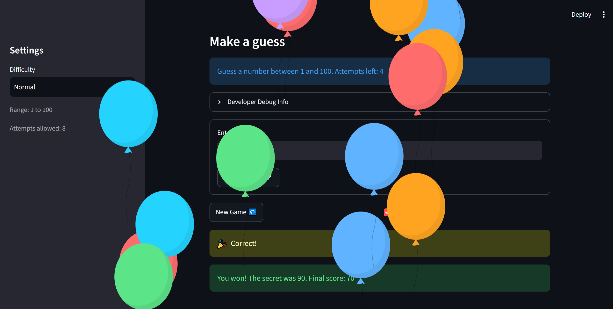

# 🎮 Game Glitch Investigator: The Impossible Guesser

## 🚨 The Situation

You asked an AI to build a simple "Number Guessing Game" using Streamlit.
It wrote the code, ran away, and now the game is unplayable. 

- You can't win.
- The hints lie to you.
- The secret number seems to have commitment issues.

*(Update: I have successfully investigated and repaired the glitches. The game is now fully playable!)*

## 🛠️ Setup

1. Install dependencies: `pip install -r requirements.txt`
2. Run the broken app: `python -m streamlit run app.py`

## 🕵️‍♂️ Your Mission

1. **Play the game.** Open the "Developer Debug Info" tab in the app to see the secret number. Try to win.
2. **Find the State Bug.** Why does the secret number change every time you click "Submit"? Ask ChatGPT: *"How do I keep a variable from resetting in Streamlit when I click a button?"*
3. **Fix the Logic.** The hints ("Higher/Lower") are wrong. Fix them.
4. **Refactor & Test.** - Move the logic into `logic_utils.py`.
   - Run `pytest` in your terminal.
   - Keep fixing until all tests pass!

## 📝 Document Your Experience

- [x] **Game Purpose**: The game is a classic "Guess the Number" game where the user tries to guess a secret number within a specific range (depending on difficulty) and limited attempts. The goal is to guess correctly in as few attempts as possible to get a high score.
- [x] **Bugs Found**: 
  1. Reversed High/Low hints (e.g., guessing 80 when the answer is 91 said "Go LOWER").
  2. Incorrect/arbitrary score calculation (score went negative or gave weird numbers).
  3. "New Game" button freeze (game status didn't reset, requiring a page refresh).
  4. Edge-case input bug: Decimals (e.g., 22.3) were truncated to integers (22) and falsely triggered a win.
- [x] **Fixes Applied**: 
  - Refactored core logic into `logic_utils.py` to separate UI from game rules.
  - Rewrote `check_guess` to return the correct hints.
  - Rewrote `update_score` to start at 100 and deduct points logically.
  - Fully reset `st.session_state` on "New Game" to fix the freeze.
  - Added strict integer validation using `is_integer()` to reject decimals.

## 📸 Demo Walkthrough

1. User starts a new game on "Normal" difficulty. The game selects a random secret number.
2. User enters a guess of `40`. The game correctly returns "Go HIGHER!" and deducts 5 points.
3. User enters a guess of `70`. The game correctly returns "Go LOWER!" and deducts 5 points.
4. User enters an invalid input like `22.3`. The game rejects it with "Please enter a valid integer." (No points deducted).
5. User enters the correct secret number. The game displays a win message with the final score.
6. User clicks "New Game" and the state instantly resets to start a fresh round without needing a page refresh.

**Screenshot**: 


## 🧪 Test Results

```
================================ test session starts ================================
platform win32 -- Python 3.11.9, pytest-9.1.1, pluggy-1.7.0
rootdir: C:\Users\linzh\ai110-module1show-gameglitchinvestigator-starter
plugins: anyio-4.15.1
collected 6 items                                                                    

tests\test_game_logic.py ......                                                [100%]

================================= 6 passed in 0.03s =================================
```

## 🚀 Stretch Features

- [x] **Challenge 1: Advanced Edge-Case Testing** - Added `pytest` cases to strictly reject decimals (e.g., `46.4`) and non-numeric strings to prevent false wins.
- [x] **Challenge 2: Feature Expansion** - Added a dynamic "Guess History" sidebar that tracks all valid and invalid guesses using `st.session_state`.
- [x] **Challenge 3: Professional Documentation** - Added Google-style docstrings and type hints to all functions in `logic_utils.py`.
- [x] **Challenge 4: Enhanced Game UI** - Implemented color-coded hints for better user experience (see description below).
- [x] **Challenge 5: AI Model Comparison** - Documented the comparison between GitHub Copilot and Deepseek in `ai_interactions.md`.
